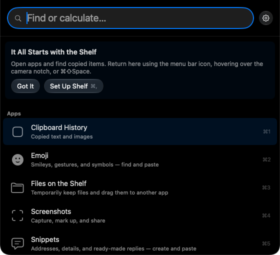
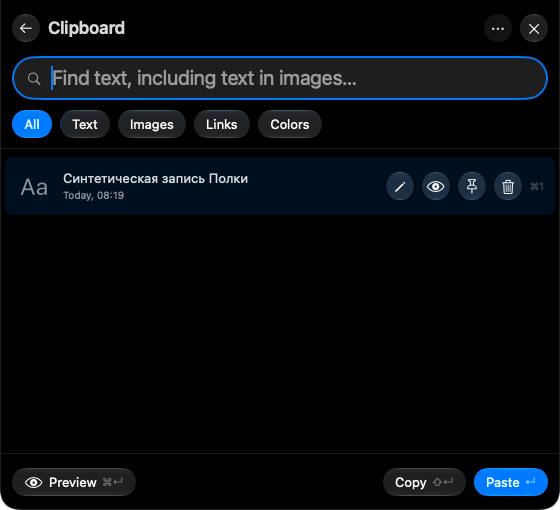
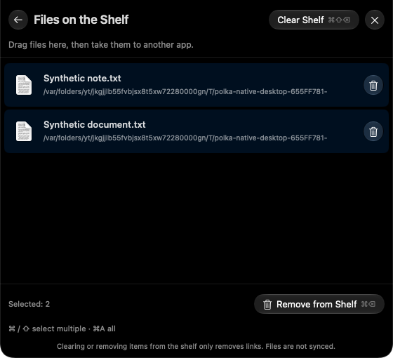

# Polka

Your apps, clipboard, and files, one shortcut away.

Polka is a native macOS utility that puts an app launcher, clipboard history, reusable snippets, and a temporary file shelf at the top of your screen. Open it, find what you need, and get back to work.

**macOS 27+ · Apple silicon · English and Russian · [MIT license](LICENSE)**

[Download the latest release](https://github.com/mishankov/polka/releases/latest) · [Report a bug or suggest a feature](https://github.com/mishankov/polka/issues)



## Find it on the shelf

Open Polka with **⌘⇧Space**, its menu bar icon, or by hovering over the camera notch. It also works on displays without a notch.

- **Launch apps.** Search by name, initials, or even a small typo or the wrong keyboard layout. Polka learns which apps you use most.
- **Calculate and convert.** Type `1250 * 3`, `10 inches in cm`, or `18:00 Moscow in London`. See the result immediately and press Enter to copy it.
- **Search across your clipboard and snippets.** Find saved text directly from the launcher, including words recognized in copied images.

## Keep useful things within reach

### Clipboard history and snippets

Find text and images you copied earlier with **⌘⇧V**. Search, preview, pin useful entries, and paste them back into your work. Polka recognizes text in images on your Mac, so you can search a screenshot or copy its text.

Save addresses, standard replies, and other text you use often as **Snippets**. Give them an optional title, search by title or content, and edit them whenever you need. Snippets stay separate from clipboard history and its retention settings.



### Files between apps

Drag files or folders from Finder to the top center of your screen, then drag them from Polka into another app. Select several items to drag them together. Removing an item from the shelf only removes its reference; your original file stays where it is. The shelf holds these references until you quit Polka.



### Emoji and activity indicators

Find emoji by name or keyword, browse categories, and choose a skin tone. Copy or paste your selection from the keyboard.

Optional camera and microphone indicators sit by the notch while those devices are active. You can switch each indicator on or off independently.

## Local by default

Polka works without an account or API key. Clipboard history and snippets are encrypted on your Mac; image text recognition runs locally. You can pause clipboard recording, choose a retention period, or disable individual built-in tools.

Optionally sync clipboard history and snippets between your Macs on the same local network. Pair them with a one-time code in **Settings → Clipboard**. Transfers go directly between paired Macs over TLS, without a cloud account, and receiving an entry does not replace your current clipboard.

Polka skips clipboard data marked as confidential or temporary by the source app. Unmarked sensitive text can still be saved. [Storage, limits, and sync details](docs/data.md).

## Install

You need **macOS 27 or later** and an **Apple silicon Mac (M1 or newer)**.

Download the DMG from the [latest release](https://github.com/mishankov/polka/releases/latest), open it, and drag **Polka** into **Applications**. Releases are self-signed and are not notarized by Apple. If macOS blocks the first launch, try opening Polka, then use **System Settings → Privacy & Security → Open Anyway**.

Alternatively, install the latest stable release from Terminal:

```sh
curl -fsSL https://raw.githubusercontent.com/mishankov/polka/master/scripts/install.sh | /bin/bash
```

The [installer](scripts/install.sh) checks the download's SHA-256 checksum and signature integrity, installs `/Applications/Polka.app`, clears its quarantine flag, and opens it. Xcode and Homebrew are not needed. Quit an existing Polka instance from its menu bar menu before reinstalling.

Polka runs in the menu bar without a Dock icon. Automatic pasting requires **Accessibility** permission; you can always copy an entry and paste it manually with **⌘V**. macOS may also ask for Keychain access to **polka Safe Storage** to unlock your history. Later updates are available in **Settings → About**.

[Detailed installation and first-launch help](docs/installation.md).

## Start with the keyboard

Open the shelf, type to search, use the arrow keys to select a result, and press **Enter** to use it.

| Action | Default shortcut |
| --- | --- |
| Open the shelf | ⌘⇧Space |
| Open clipboard history | ⌘⇧V |
| Open settings | ⌘, |
| Use the selected result | Enter |
| Copy a clipboard entry, snippet, or emoji without pasting | ⇧Enter |
| Preview a clipboard entry or snippet | ⌘Enter |
| Create a snippet while in Snippets | ⌘N |
| Save a snippet while editing | ⌘Enter |

Change the global shortcuts and app language in settings. Disable built-in tools you do not use in **Settings → Built-in Apps**.

## Help and contribute

Use [GitHub Issues](https://github.com/mishankov/polka/issues) for bugs and feature requests. For a bug, include your Polka and macOS versions, steps to reproduce it, and what you expected to happen.

Further guides: [installation](docs/installation.md), [conversions](docs/conversions.md), [data and sync](docs/data.md), and [development](docs/development.md).

Polka is built with Swift, SwiftUI, and AppKit. To work on it, use macOS 27+, Apple silicon, Xcode 27, and Swift 6:

```sh
./polka setup
./polka dev
```

Run `./polka verify` before submitting a change. Desktop checks use the project's isolated macOS VM; see the [development guide](docs/development.md) for setup and the [architecture guide](docs/architecture.md) for the code structure.

Licensed under [MIT](LICENSE).
